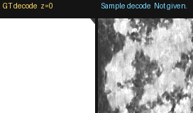
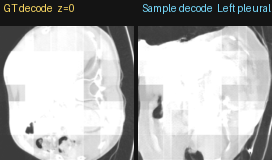
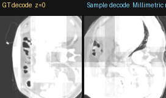

# LoRAD

**LoRAD** (*Low-Resource Adaptive Diffusion*) is a text-to-CT generation method that learns a 3D latent diffusion model under limited paired report–volume data, with soft field-of-view (FOV) conditioning and structural consistency losses for more anatomically plausible volumes.

---

## Team

| Name | Affiliations |
|------|----------------|
| **Prateek Mathur** | University College Dublin (UCD); Rinn-AI |
| **Paul Banahan** | University College Dublin (UCD); Mater Misericordiae University Hospital; Rinn-AI |
| **Aonghus Lawlor** | University College Dublin (UCD); Rinn-AI |

---

## Method overview

LoRAD generates chest CT from free-text radiology reports in a compressed latent space:

1. **Encode** or **Downsize** CT with a frozen **MedVAE** 3D CT autoencoder after a fixed resize–pad preprocess → latents of shape `(48, 96, 96)`.
2. **Diffuse** in latent space with a 3D U-Net (MedSyn-style) conditioned on frozen **CXR-BERT** report embeddings (**v-prediction**).
3. **Regularize** predicted clean latents with:
   - axial **Sobel edge** L1 (in-plane structure), and
   - **tri-planar first-difference** L1 (inter-slice / 3D consistency; LiFT-C–style spatial term).
4. **Condition on FOV** via a 9-D content-extent descriptor derived from each training latent (MLP → cross-attention token), with **null-FOV dropout** so inference can run from text alone.
5. **Sample** with **classifier-free guidance (CFG)**; FOV is always the learned null token at test time.
6. **Decode** with MedVAE to HU and write NIfTI with a canonical LAS affine / spacing suitable for CT-RATE-style evaluation.

Loss terms are learned adaptively. An EMA of the network is used for visualization and inference.

```
Report ──► CXR-BERT ──┐
                      ├─► 3D Latent U-Net (v-pred) ──► DDIM + CFG ──► MedVAE decode ──► CT
FOV token (train) ────┘         ▲
null FOV (infer) ───────────────┘
         + edge + inter-slice consistency on x₀
```

### Pretrained models

| Component | Role |
|-----------|------|
| [MedVAE](https://arxiv.org/abs/2502.14753) (`medvae_4_1_3d`) | Frozen CT VAE encode/decode |
| CXR-BERT | Frozen report text encoder (cross-attention conditioning) |
| [MedSyn](https://ieeexplore.ieee.org/abstract/document/10566053)-style 3D U-Net | Latent diffusion backbone (adapted for latent-only input + FOV/CFG) |

---

## Data access and preprocessing

**Data access.** All volumes and reports come from **[CT-RATE](https://huggingface.co/datasets/ibrahimhamamci/CT-RATE)** only. This repository does **not** redistribute CT volumes, reports, or latents. Obtain CT-RATE through its official release and license.

**Training subset.** We used an axial-quality subset of CT-RATE cases for which MedVAE latents were available (**596 volumes**, **495 patients**). The exact CT-RATE volume filenames are listed in:

[`data/training_case_list.txt`](data/training_case_list.txt)

**Preprocessing (local).** Resize–pad CT to a fixed encode grid `(192, 384, 384)`, encode with MedVAE → latent `(48, 96, 96)`, then z-score normalize with dataset mean/std. FOV features are computed on-the-fly from each latent (per-axis content extent, center, activity). No organ masks are used.

**Training / validation.** There was **no held-out validation or evaluation split**. The full axial-quality subset above was used for training. Model selection used train loss plus qualitative MedVAE-decode visualizations.

### Training progress

EMA samples decoded with MedVAE during training (GT left, sample right; axial scroll):

| Epoch 10 | Epoch 150 | Epoch 300 |
|:--------:|:---------:|:---------:|
|  |  |  |

---

## Repository layout

```
LoRAD/
  README.md
  requirements.txt
  LICENSE
  assets/training/                  # training progress GIFs (epochs 10 / 150 / 300)
  data/
    training_case_list.txt          # CT-RATE filenames used for training
  saved_models/
    resizepad_48x96x96_fov_cfg/
      last.ckpt                     # final submitted EMA checkpoint (Git LFS)
  lorad/
    dataloader.py
    diffusion_model.py
    train.py
    infer.py
```

External code dependencies (not vendored):

- [MedVAE](https://github.com/StanfordMIMI/MedVAE)
- MedSyn-compatible `MedSyn/src` on `PYTHONPATH` (`Unet3D`, `GaussianDiffusion`, `EMA`, utils)
- CXR-BERT tokenizer + encoder directory for text embeddings

---

## Installation

```bash
# Requires Git LFS for the checkpoint
git lfs install
git clone https://github.com/pmath2012/LoRAD.git
cd LoRAD

# Python 3.10+, CUDA PyTorch matching your GPU
pip install -r requirements.txt
pip install -e /path/to/MedVAE

export PYTHONPATH="/path/to/MedSyn/src:${PYTHONPATH}"
export PYTHONPATH="/path/to/LoRAD:${PYTHONPATH}"
```

---

## Training settings

```bash
python -m lorad.train \
  --csv_path data/train.csv \
  --tokenizer_path checkpoints/bert_tokenizer \
  --stats_path data/latent_mean_std.json \
  --output_dir runs/lorad \
  --prediction_type v \
  --loss_type edge+l2+isc \
  --null_cond_prob 0.1 \
  --null_fov_prob 0.15 \
  --cond_scale 3.0 \
  --batch_size 2 \
  --max_epochs 500 \
  --decode_vis \
  --decode_every_n_epochs 10
```

Submitted training configuration (summary):

| Setting | Value |
|---------|--------|
| Objective | v-prediction + edge + tri-planar ISC |
| Batch size | 2 |
| Epochs | 500 |
| Text null dropout | 0.1 |
| FOV null dropout | 0.15 |
| CFG (viz / infer) | 3.0 |
| Optimizer | AdamW, LR \(2\times10^{-4}\) |
| Checkpoints | `light_model_best.ckpt`, `last.ckpt` |

Resume:

```bash
python -m lorad.train ... --checkpoint_path runs/lorad/last.ckpt --max_epochs 500
```

---

## Inference (input / output formats)

**Input** (`prompts.json`):

```json
[
  {"input_image_name": "case_001", "report": "No acute cardiopulmonary process."}
]
```

**Output:** one HU NIfTI per case, `<input_image_name>.nii.gz`, shape `(192, 384, 384)`, LAS orientation, voxel spacing `(1.0, 1.0, 1.8828)` mm.

```bash
# Point LORAD_MODELS_DIR at a folder containing:
#   light_model.ckpt  (copy/symlink of saved_models/.../last.ckpt)
#   bert_tokenizer/
#   latent_mean_std.json
#   hf_cache/   (optional offline MedVAE cache)

export LORAD_MODELS_DIR=./models
export LORAD_INPUT=./prompts.json
export LORAD_OUTPUT=./outputs
export CFG_SCALE=3.0

python -m lorad.infer
```

Inference always uses the **null FOV** token (report + CFG only). DDIM steps: **75**.

---

## Final weight file (leaderboard submission)

 Submission checkpoint [`saved_models/resizepad_48x96x96_fov_cfg/last.ckpt`](saved_models/resizepad_48x96x96_fov_cfg/last.ckpt) |

---

## Results

Official scores from the [CT Volume Generation](https://research.forithmus.com/challenges/ct-volume-generation#leaderboard) leaderboard (forithmus, Main 2026), entry **Prateek Mathur** 

| Metric | Value |
|--------|------:|
| **FVD (CTNet)** ↓ | **0.751** |
| **FID 2.5D (Avg)** ↓ | **405.226** |
| **CT-CLIPScore (Avg)** ↑ | **14.940** |
| FID 2.5D (XY) | 561.085 |
| FID 2.5D (XZ) | 324.316 |
| FID 2.5D (YZ) | 330.278 |
| CT-CLIPScore (T2I) | 14.430 |
| CT-CLIPScore (I2I) | 15.450 |

---

## Limits and limitations

The method is trained on a small CT-RATE subset because of compute and storage limits. Model selection relied on qualitative visual assessment of decoded samples rather than a held-out validation split or metric-based checkpointing. Because diffusion is trained in MedVAE latent space with a frozen decoder, MedVAE’s patchwise reconstruction can introduce tiling or seam-like artifacts that resemble anatomical structure in some samples. Our submission emphasized structural regularization via Sobel edge and tri-planar consistency losses to improve sharpness and inter-slice coherence, but we did not explore richer text-encoding pathways (e.g., stronger language models, report-section fusion, or text-side ablations).

---

## References

[1] M. Varma et al., “MedVAE: Efficient Automated Interpretation of Medical Images with Large-Scale Generalizable Autoencoders,” arXiv:2502.14753, 2025. [Online]. Available: https://arxiv.org/abs/2502.14753

[2] Y. Xu et al., “MedSyn: Text-Guided Anatomy-Aware Synthesis of High-Fidelity 3-D CT Images,” *IEEE Trans. Med. Imag.*, vol. 43, no. 10, pp. 3648–3660, Oct. 2024, doi: 10.1109/TMI.2024.3415032.

[3] I. Sobel and G. Feldman, “A 3×3 isotropic gradient operator for image processing,” Stanford Artificial Intelligence Laboratory (SAIL), 1968. (Axial Sobel edge maps with L1 matching on predicted vs. target latents.)

[4] Tri-planar / inter-slice consistency via first-order finite differences along depth, height, and width with L1 matching (LiFT-C–style spatial consistency term).

[5] Soft field-of-view (FOV) / content-extent conditioning derived from latents, with null-FOV dropout for text-only inference.

[6] I. E. Hamamci et al., “CT-RATE,” Hugging Face Datasets. [Online]. Available: https://huggingface.co/datasets/ibrahimhamamci/CT-RATE

[7] J. Ho and T. Salimans, “Classifier-Free Diffusion Guidance,” arXiv:2207.12598, 2022. [Online]. Available: https://arxiv.org/abs/2207.12598

[8] T. Salimans and J. Ho, “Progressive Distillation for Fast Sampling of Diffusion Models,” in *Proc. Int. Conf. Learn. Represent. (ICLR)*, 2022. (v-prediction parameterization.)

---

## Usage terms

- **Code** in this repository is released under the [MIT License](LICENSE).
- **Weights** (`last.ckpt`) are provided for research / challenge reproducibility; redistributing or using them commercially may be restricted by upstream model and dataset licenses.
- **CT-RATE data** must be obtained from the official CT-RATE release under its terms — this repo only lists which filenames we used.
- Third-party components (**MedVAE**, **MedSyn**, **CXR-BERT**, etc.) remain under their respective licenses.
